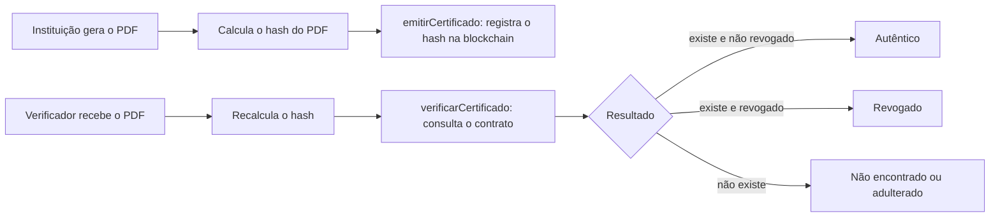

# CertChain UniSales — Relatório de Desenvolvimento e Resultados

**Disciplina:** Implantação de Tecnologia Blockchain — Engenharia de Software (EaD)
**Instituição:** Centro Universitário Salesiano (UniSales) — Vitória/ES
**Aluno:** Gustavo Cardoso
**Data:** novembro de 2026

---

## 1. Resumo

Este relatório descreve o desenvolvimento do **CertChain UniSales**, uma aplicação descentralizada (DApp) baseada em um contrato inteligente em Solidity que permite emitir, verificar e revogar **certificados e diplomas** de forma pública e à prova de adulteração. O contrato foi implantado e verificado na rede de testes **Sepolia** (Ethereum). O documento detalha o problema, a solução, as decisões técnicas, o processo de construção, os testes, os custos de gas medidos e os resultados da demonstração em rede pública.

**Resultados principais**

| Indicador | Resultado |
|---|---|
| Contrato implantado na Sepolia | `0x740845c3A154B3B7603fbe9710A1233aD4F12656` |
| Código-fonte verificado no Etherscan | Sim |
| Testes automatizados | 17 de 17 passando |
| Fluxo completo na rede pública (emitir, verificar, revogar) | Funcionou conforme o esperado |
| Dados pessoais gravados na blockchain | Nenhum (somente hash) |

---

## 2. Problema e objetivo

Certificados e declarações em PDF são fáceis de falsificar. Quem recebe o documento (empregador, outra instituição) precisa contatar manualmente a instituição emissora, o que é lento, custoso e depende da disponibilidade dela.

**Objetivo:** construir um sistema em que qualquer pessoa possa verificar, a qualquer hora e sem intermediários, se um documento foi realmente emitido pela instituição e se continua válido.

**Por que blockchain?**
- Registro imutável e com data, sem depender de um único servidor.
- Verificação pública e gratuita.
- Trilha de auditoria de emissões e revogações compartilhada por atores que não precisam confiar uns nos outros.

---

## 3. A aplicação

### 3.1 Como funciona

A ideia central é registrar na blockchain apenas o **hash** (impressão digital criptográfica) do documento. O arquivo em si continua off-chain, com a instituição e com o titular.



Alterar um único byte do PDF muda completamente o hash, então qualquer adulteração é detectada.

### 3.2 Funcionalidades do contrato

| Função | Quem pode chamar | Descrição |
|---|---|---|
| `emitirCertificado(hash, curso)` | Emissor autorizado | Registra o hash do documento com emissor, data e curso |
| `verificarCertificado(hash)` | Qualquer pessoa (consulta gratuita) | Retorna se é válido, se existe, se foi revogado, o emissor, a data e o curso |
| `revogarCertificado(hash, motivo)` | Dono ou emissor original | Marca como revogado, preservando o histórico |
| `emitirLote(hashes, curso)` | Emissor autorizado | Registra vários certificados em uma transação |
| `adicionarEmissor` / `removerEmissor` | Dono | Gerencia quem pode emitir |
| `iniciarTransferenciaPropriedade` / `aceitarPropriedade` | Dono / novo dono | Troca de dono em duas etapas |

### 3.3 Modelo de dados

```
Certificado (mapping hashDocumento => Certificado)
 ├─ emissor     : address
 ├─ emitidoEm   : uint64   (timestamp)
 ├─ revogadoEm  : uint64   (0 = ativo)
 └─ curso       : string   (dado não pessoal)

Estado global: dono, donoPendente, emissores, totalEmitidos
```

A chave de cada registro é o hash do documento. Não há nome, CPF ou matrícula na blockchain.

---

## 4. Decisões de arquitetura

| Decisão | Justificativa |
|---|---|
| Guardar somente o hash on-chain | Armazenar documentos seria caro e incompatível com a LGPD; o hash prova integridade sem expor conteúdo |
| Plataforma Ethereum (testnet Sepolia) | O valor do sistema é a confiança de terceiros desconhecidos, que cresce com a descentralização; ferramentas e explorer maduros |
| Contrato não atualizável (sem proxy) | Regras imutáveis dão previsibilidade; correções são feitas por revogação e nova emissão |
| Papéis de dono e emissores, sem bibliotecas externas | Menor superfície de ataque e código fácil de auditar |
| Transferência de propriedade em duas etapas | Evita perder o controle por endereço digitado errado |
| Erros personalizados (`error`) | Reduzem o gas em relação a mensagens de texto |
| Emissão em lote | Atende o cenário de formatura de uma turma inteira |
| Verificação como função `view` | Gratuita para quem consulta |

**Comparação de plataformas avaliadas:** Ethereum (descentralização maior, ferramentas mais amplas, custo em geral mais alto) e BNB Smart Chain (custo em geral mais baixo, porém com conjunto menor de validadores). Como ambas são compatíveis com a EVM, o mesmo código poderia ser migrado no futuro sem reescrita.

---

## 5. Como foi desenvolvido

### 5.1 Ferramentas

| Item | Tecnologia |
|---|---|
| Linguagem | Solidity 0.8.24 (otimizador com 200 runs, EVM `cancun`) |
| Ambiente | Hardhat 2.22 (Node.js) |
| Testes | Mocha, Chai e `hardhat-chai-matchers` |
| Biblioteca web3 | ethers v6 |
| Rede de testes | Sepolia |
| Explorer e verificação | Etherscan (`hardhat-verify`) |
| Provedor RPC | Alchemy |
| Carteira | MetaMask (conta exclusiva para testes) |

### 5.2 Etapas

1. **Concepção:** escolha do caso de uso (tema sugerido no enunciado), comparação de plataformas e modelagem dos dados.
2. **Contrato:** implementação em Solidity com foco em segurança (controle de acesso, validações de entrada, eventos para auditoria).
3. **Testes automatizados:** escritos junto ao contrato, cobrindo caminhos de sucesso e de falha.
4. **Medição de gas:** script que executa as operações principais e tabula o consumo.
5. **Preparação da implantação:** configuração da rede Sepolia, variáveis de ambiente e scripts de deploy e demonstração.
6. **Validação do ambiente:** script que testa as credenciais sem gastar gas (formato das chaves, rede do RPC, saldo e chave do Etherscan).
7. **Deploy, verificação e demonstração** na Sepolia.

### 5.3 Estrutura do repositório

```
contracts/CertificadoVerificavel.sol   # smart contract
test/CertificadoVerificavel.test.js    # 17 testes
scripts/deploy.js                      # deploy na Sepolia
scripts/interagir.js                   # demonstração (emitir, verificar, revogar)
scripts/medir-gas.js                   # tabela de consumo de gas
scripts/testar-env.js                  # validação do ambiente
docs/                                  # proposta e relatórios
README.md                              # instruções de compilação, teste e deploy
```

### 5.4 Dificuldades encontradas e como foram resolvidas

| Dificuldade | Solução |
|---|---|
| RPC configurado na rede errada: o script de validação mostrou `chainId 1` (mainnet) em vez de `11155111` (Sepolia) | Troca do endereço do provedor para o endpoint Sepolia, evitando qualquer operação na mainnet; o teste do ambiente passou a confirmar a rede antes do deploy |
| Linha duplicada na variável do RPC (`URL=` repetido) | Correção do `.env` e nova validação |
| Carteira sem saldo | Obtenção de ETH de teste em faucets da Sepolia |
| Comandos de exemplo em Bash que não funcionam no PowerShell (Windows) | Equivalentes em PowerShell para criar arquivos e definir variáveis de ambiente |
| Custo de gas na Sepolia muito acima do medido localmente | Análise da causa provável (seção 7.3) e registro no relatório |

O script de validação do ambiente se mostrou útil: detectou o erro de rede **antes** de qualquer transação, evitando uma tentativa de deploy no lugar errado.

---

## 6. Testes

Foram escritos **17 testes automatizados**, todos passando (`npx hardhat test`).

| Grupo | O que é verificado |
|---|---|
| Implantação | Dono definido e autorizado como emissor; contador zerado |
| Emissão | Registro correto com evento; rejeição de quem não é emissor, de hash zero e de hash duplicado |
| Verificação | Retorna válido para emitido; inexistente para hash desconhecido (documento adulterado); consulta pública por qualquer endereço |
| Revogação | Dono e emissor original podem revogar; terceiros não; não revoga duas vezes nem inexistente; histórico preservado |
| Lote | Registra vários de uma vez; rejeita lote vazio; lote com duplicado reverte tudo |
| Governança | Adicionar e remover emissores; permissões; transferência de propriedade em duas etapas e perda de poder do dono antigo |

---

## 7. Resultados

### 7.1 Implantação na Sepolia

| Item | Valor |
|---|---|
| Rede | Sepolia (testnet pública) |
| Endereço do contrato | `0x740845c3A154B3B7603fbe9710A1233aD4F12656` |
| Etherscan | https://sepolia.etherscan.io/address/0x740845c3A154B3B7603fbe9710A1233aD4F12656#code |
| Código verificado | Sim (aba Contract com selo verde) |
| Tx de deploy | `0xc723eba330fb854a3b5d2bb7ec8c005e7243750df27c72a916506df6621e3909` |
| Gas do deploy | 5.352.938 a 1,0 gwei |
| Custo do deploy | 0,005352938 ETH de teste |

### 7.2 Demonstração na rede pública

Foi executado o fluxo completo (`npm run demo`) sobre um documento de teste:

| Etapa | Resultado | Transação | Gas |
|---|---|---|---:|
| Antes da emissão | válido = falso, existe = falso | (consulta, sem gas) | 0 |
| `emitirCertificado` | válido = verdadeiro, existe = verdadeiro, curso "Engenharia de Software - UniSales" | `0x80ded6f3c31038e244dd2af82fee667f68d01e22d6c651519188f1e6f2834f0f` | 686.425 |
| `revogarCertificado` | válido = falso, existe = verdadeiro, revogado = verdadeiro | `0xdcd76ac9d3e18c28ae6a33c1022be5156418d7e12fec8d940a798589fca9b310` | 134.297 |

Hash do documento da demonstração: `0x7879a76495663033346130b6cc3059dc8f792f46cb7923d0c833128197d329be`.

O resultado confirma os requisitos funcionais: o documento não verifica antes de ser emitido, passa a verificar depois e deixa de ser válido após a revogação, **sem apagar o registro**, que permanece para auditoria.

### 7.3 Custos de gas

| Operação | Rede local (Hardhat) | Sepolia | Razão |
|---|---:|---:|---:|
| Deploy do contrato | 788.308 | 5.352.938 | 6,8x |
| `emitirCertificado` | 119.595 | 686.425 | 5,7x |
| `revogarCertificado` | 52.121 | 134.297 | 2,6x |
| `emitirLote` (10 certificados) | 763.103 | não medido | — |
| `emitirLote` (por certificado) | 76.310 | não medido | — |
| `adicionarEmissor` | 47.333 | não medido | — |
| `verificarCertificado` | 0 (view) | 0 (view) | — |

**Análise.** O bytecode tem 3.183 bytes, então o tamanho do código não explica a diferença entre a rede local e a Sepolia. A explicação mais provável é a atualização **Glamsterdam**, já ativada na Sepolia: a EIP-8037 reajusta para cima o custo de criar estado novo na rede (contas, slots de armazenamento e código de contratos), e a rede local do Hardhat ainda aplica os preços anteriores. O padrão observado é coerente com isso, pois as operações que gravam mais dados novos (deploy e emissão) subiram mais do que a revogação, que só altera um campo existente. Não decompus o gas operação por operação, então isso é uma hipótese fundamentada, não uma medição. O cronograma de ativação na mainnet deve ser conferido; enquanto a atualização não estiver ativa lá, os custos tendem a ficar mais próximos dos medidos localmente.

A economia de cerca de 36% da emissão em lote (de 119.595 para 76.310 de gas por certificado) foi medida apenas em rede local e não foi reproduzida na Sepolia.

**Implicação de projeto.** Como o custo de gravar estado novo tende a subir, a decisão de guardar somente o hash on-chain (e não o documento nem dados pessoais) se mostra ainda mais acertada.

---

## 8. Governança

O modelo é **híbrido**:

| Aspecto | On-chain | Off-chain |
|---|---|---|
| Quem pode emitir | Mapeamento de emissores, gerido pelo dono | Conselho Acadêmico decide quem é emissor |
| Quem pode revogar | Dono ou emissor original | Política de revogação: fraude, erro de emissão, decisão judicial |
| Alteração do contrato | Nenhuma (sem proxy) | Nova versão exige novo deploy e comunicação pública |
| Troca do dono | Duas etapas | Aprovação da reitoria |

O dono controla apenas a lista de emissores e a revogação. Ele **não consegue** apagar, editar ou falsificar registros já emitidos. Em produção, recomenda-se que o dono seja uma carteira **multisig**, eliminando o ponto único de falha de uma chave privada. A transferência em duas etapas já permite essa migração sem novo deploy.

---

## 9. Aspectos legais e regulatórios

- **LGPD (Lei 13.709/2018):** dados gravados em blockchain são praticamente impossíveis de apagar, o que conflita com o direito de eliminação. A mitigação é por projeto: só o hash vai para a rede, sem nome, CPF ou matrícula.
- **Diploma digital e assinatura eletrônica:** a emissão oficial de diplomas segue as regras do MEC (Portaria MEC 554/2019) e usa certificados ICP-Brasil (MP 2.200-2/2001); a Lei 14.063/2020 trata dos tipos de assinatura eletrônica. O registro em blockchain **não substitui** esses requisitos, sendo prova complementar de integridade e data.
- **Valor probatório:** o hash comprova que o documento existia e não foi alterado, mas não comprova por si só a identidade de quem o emitiu fora do contexto institucional; por isso o endereço oficial do contrato deve ser divulgado pela instituição.
- **Marco legal dos criptoativos (Lei 14.478/2022):** o sistema não cria nem negocia token ou ativo virtual; o ETH é usado apenas para pagar taxas.
- **Responsabilidade:** a instituição permanece responsável pelo conteúdo emitido e pela custódia das chaves.

> Os dispositivos legais acima devem ser conferidos nas fontes oficiais antes da entrega final.

---

## 10. Limitações e trabalhos futuros

- Interface web para verificação (arrastar e soltar o PDF e consultar o contrato).
- Dono como carteira multisig e emissores por unidade acadêmica.
- Medir `emitirLote` e demais operações na Sepolia para comparar com a rede local.
- Avaliar migração para uma rede de menor custo compatível com EVM, se o volume de emissões justificar.
- Integração com o fluxo oficial de diploma digital (ICP-Brasil).
- Auditoria de segurança formal antes de qualquer uso em produção; o projeto foi implantado somente em testnet.

---

## 11. Conclusão

O CertChain UniSales cumpre o objetivo proposto: um contrato inteligente que registra e permite verificar certificados de forma pública, sem expor dados pessoais, implantado e verificado em uma testnet pública e validado por testes automatizados e por uma demonstração completa na rede. O trabalho também mostrou, na prática, que o custo de gas depende das regras da rede (diferença entre a simulação local e a Sepolia), o que reforça a escolha de minimizar o que é gravado on-chain.

---

## 12. Links da entrega

| Item | Link |
|---|---|
| Contrato na Sepolia | https://sepolia.etherscan.io/address/0x740845c3A154B3B7603fbe9710A1233aD4F12656#code |
| Transação de deploy | https://sepolia.etherscan.io/tx/0xc723eba330fb854a3b5d2bb7ec8c005e7243750df27c72a916506df6621e3909 |
| Transação de emissão | https://sepolia.etherscan.io/tx/0x80ded6f3c31038e244dd2af82fee667f68d01e22d6c651519188f1e6f2834f0f |
| Transação de revogação | https://sepolia.etherscan.io/tx/0xdcd76ac9d3e18c28ae6a33c1022be5156418d7e12fec8d940a798589fca9b310 |
| Vídeo de demonstração | https://youtu.be/M7SitUQL8ZY |
